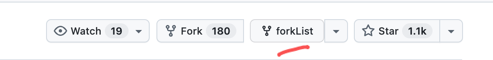

### zhihu
查看文章时候，左侧下是目录 h1-h4提取
### 小红书 。
  支持 pc网页版打开，新建、编辑笔记时候，直接粘贴图片（识别剪贴板），不用上传文件
### 公众号图文
  新建、编辑笔记时候，直接粘贴图片（识别剪贴板），不用上传文件
  
### github-notifications
增强 GitHub 通知页面的仓库信息展示，帮助快速回忆项目用途并直接进入相关页面，主要功能包括：

- 在通知列表中显示仓库简介、主要开发语言等信息，并提供仓库主页等快捷入口。
- 在仓库主页的 Fork 操作旁添加 `forkList` 按钮，通知页面保持原有展示。
- 点击 `forkList` 可查看当前项目的全部 Fork 列表。


仓库主页中的 `forkList` 按钮示例：




### 重建git历史
尤其git历史项目过多的，精简只保留最近n条
偶尔几条commit包含了不能提交的信息，公司名/密钥等.可用来重建

```
bash rebuild-git-short-history.sh \
  -n 30 \
  -e HEAD \
  -b github-main \
  --squash A..B \
  --squash-msg "合并 A/B，移除敏感信息" \
  --squash C..D \
  --squash-msg "整理 C/D 提交"
```


### 废弃  github_enhance.js 


