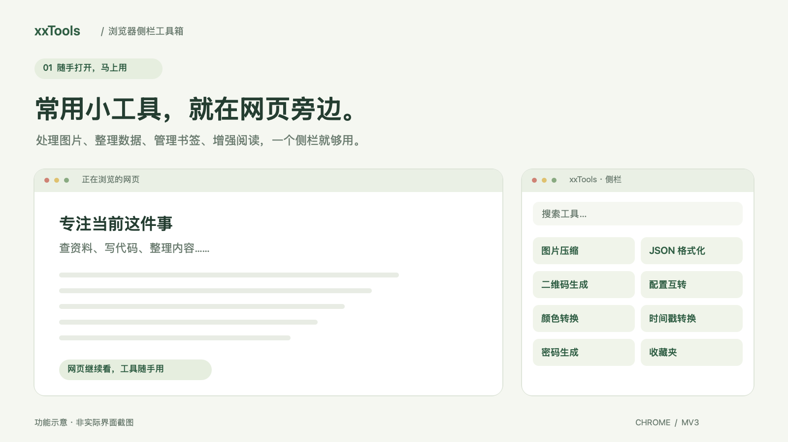
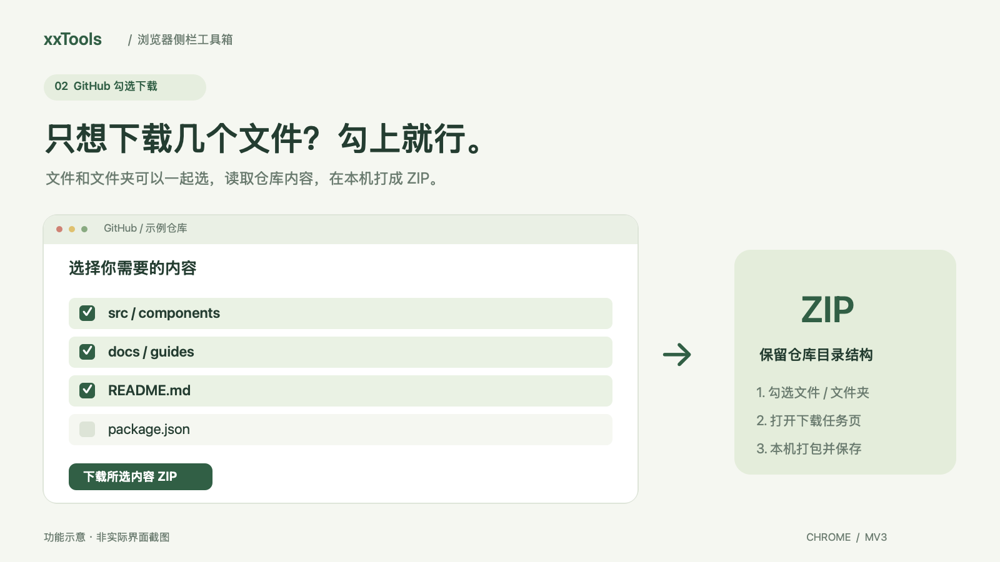
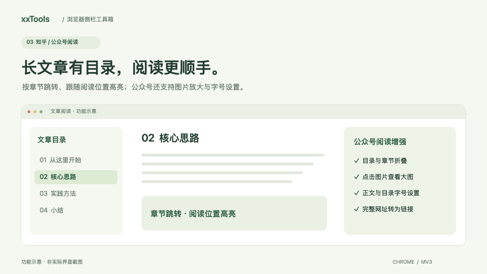
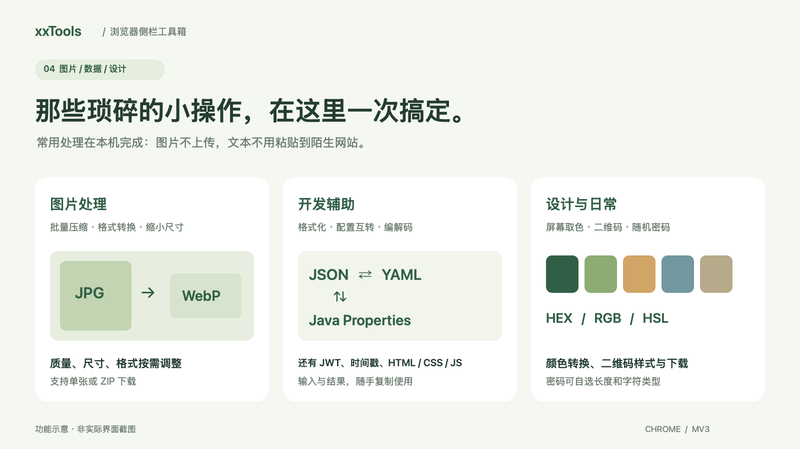
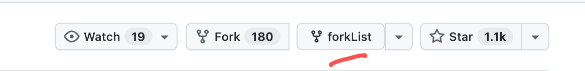

# xxTools · 浏览器侧栏工具箱

**常用小工具，就在网页旁边。**

xxTools 是一个 Chrome 浏览器扩展，把图片处理、开发辅助、书签管理和阅读增强放进侧栏。查资料、写代码、整理内容时，随手打开就能用，少开几个工具网站，少来回切换几次页面。

[下载安装包](https://github.com/qbmiller/xxTools/releases) · [安装与详细说明](xxTools/README.md#安装与从旧版升级) · [反馈问题](https://github.com/qbmiller/xxTools/issues)



## 它能帮你做什么？

| 你想做的事 | 打开 xxTools |
| --- | --- |
| 只要 GitHub 仓库里的几个文件或某个文件夹 | 勾选需要的内容，下载成 ZIP，保留仓库目录结构 |
| 图片太大，想批量压缩或转换格式 | 本机处理 JPG / PNG / WebP，调整质量和尺寸，单张或打包下载 |
| 看知乎、公众号长文章，翻来翻去找章节 | 自动生成文章目录，点击跳转，跟随阅读位置高亮 |
| 临时处理接口数据或配置文件 | JSON 校验、美化、压缩；JSON / YAML / Properties 互转；JWT 解析 |
| 转换颜色、生成二维码或随机密码 | 屏幕取色与 HEX / RGB / HSL 转换，自定义二维码样式，生成可选字符类型的密码 |
| 收藏夹越来越乱，误删后想找回来 | 搜索与按网站分组、拖动整理、重命名；在 xxTools 内删除的书签保留 30 天回收站 |
| Session Buddy 等挂起链接打不开了 | 尝试提取原始网址并恢复当前标签，原始网址已丢失时无法恢复 |

还包括 Unicode / URL / Base64 等编解码、HTML / CSS / JS 美化压缩、时间戳转换、字数统计、DNS 查询与扩展请求头查看。工具支持搜索、收藏和最近使用。

## GitHub：勾选什么，就下载什么

不用为几个文件下载整个仓库。打开 GitHub 仓库，勾选文件或文件夹，点击「下载 ZIP」，在独立任务页完成下载和本机打包。私有仓库或 API 限流时，可配置具有相应读取权限的 Token。



## 阅读：长文章，也能有条理

**知乎专栏**支持文章目录、章节跳转和阅读位置高亮；已有知乎原生目录时不重复添加。**公众号文章**还支持章节折叠、图片放大、目录与正文字号设置、完整网址转链接。各项增强可在工具页开关。



## 图片、数据、设计：琐碎操作顺手完成

图片压缩不上传原图；JSON、配置互转、编解码、取色转换、二维码和密码生成等在本机处理。切换工具时保留当前侧栏会话中的输入，方便接着操作。



> 以上 4 张图片为功能示意，非实际界面截图。仅展示已实现的能力；标记「正在开发中」的工具入口（如 OCR、PDF、AI 总结）暂不可用。

## 几步开始使用

1. 在 [Releases](https://github.com/qbmiller/xxTools/releases) 下载 `xxTools-<版本>-chrome.zip`，解压到固定目录。
2. 打开 `chrome://extensions/`，启用「开发者模式」。
3. 点击「加载已解压的扩展程序」，选择**直接包含 `manifest.json` 的文件夹**。
4. 点击 xxTools 扩展图标打开侧栏；要使用网页增强，请刷新已打开的 GitHub、知乎或公众号页面。

无需安装 Node.js。Chrome 会持续读取所选文件夹，安装后请保留该目录。更新与源码安装方法见 [完整使用说明](xxTools/README.md)。

## 数据在哪里处理？

- **本机处理**：图片、格式化、配置转换、编解码、二维码、密码生成等工具不上传输入；书签管理使用浏览器原有书签，编辑会影响真实书签，并遵循浏览器的同步设置。
- **按需联网**：GitHub 下载通过 `api.github.com` 读取内容；DNS 查询向 Cloudflare DNS-over-HTTPS 发送待查域名；请求头工具请求 `httpbin.org`，展示的是这次扩展请求的请求头。
- **指定站点增强**：网页增强作用于 GitHub、知乎专栏和公众号文章，不申请全站访问权限。阅读增强在文章页内处理；放大图片仍会请求文章原有图片来源。
- **边界明确**：JWT 工具仅解析、不验证签名；书签回收站只记录在 xxTools 内删除的内容；挂起标签恢复只处理当前标签。

## 从源码运行

基于 WXT + Vue 3 + TypeScript，使用 Chrome Manifest V3。需要 Node.js 22.12+ 或 24+ LTS。

```sh
cd xxTools
npm ci
npm run build
```

构建后在 Chrome 加载 `xxTools/.output/chrome-mv3`。开发、新增工具和验证方式见 [开发文档](xxTools/README.md#开发与验证)。

---

## 仓库中的其他脚本

除 xxTools 扩展外，本仓库还保留一些可独立使用的脚本。以下是原有脚本说明。


### zhihu
查看文章时候，左侧下是目录 h1-h4提取
### 小红书 。
  支持 pc网页版打开，新建、编辑笔记时候，直接粘贴图片（识别剪贴板），不用上传文件
### 公众号图文
  新建、编辑笔记时候，直接粘贴图片（识别剪贴板），不用上传文件
  
### github-notifications
增强 GitHub 通知页面的仓库信息展示，帮助快速回忆项目用途并直接进入相关页面，主要功能包括：

- 在通知列表中显示仓库简介、主要开发语言等信息，并提供仓库主页等快捷入口。
- 在仓库主页的 Fork 操作旁添加 `forkList` 按钮，通知页面保持原有展示。
- 点击 `forkList` 可查看当前项目的全部 Fork 列表。


仓库主页中的 `forkList` 按钮示例：




### 重建git历史
尤其git历史项目过多的，精简只保留最近n条
偶尔几条commit包含了不能提交的信息，公司名/密钥等.可用来重建

```
bash rebuild-git-short-history.sh \
  -n 30 \
  -e HEAD \
  -b github-main \
  --squash A..B \
  --squash-msg "合并 A/B，移除敏感信息" \
  --squash C..D \
  --squash-msg "整理 C/D 提交"
```


### 废弃  github_enhance.js 


